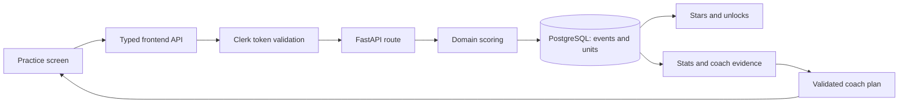

# Architecture

bopomofo has two application processes and one PostgreSQL database. Next.js owns the interface. FastAPI owns scoring, learner data, and coach decisions. ONNX Runtime runs speech recognition and voice synthesis on the CPU.

## Request and answer flow

The frontend adds the current coach step to an answer. The backend saves one event for the answer and units for its parts. Those units contain what was expected and what the learner produced. A correct answer with help is different from a correct answer from memory.

After a save, level checks and coach refresh run through `backend/app/api/notices.py`. The frontend emits `zs:answered` and `zs:levels`, so the step banner and shell update. Do not bypass this path in a new practice mode.

## Backend boundaries

| Location                                                          | Owns                                                         |
| ----------------------------------------------------------------- | ------------------------------------------------------------ |
| `app/main.py`                                                     | Application assembly, startup, and shutdown                  |
| `app/middleware.py`                                               | Body limits, errors, and CORS, in their existing order       |
| `app/api/`                                                        | HTTP parsing, response shapes, and route errors              |
| `app/audio.py`, `app/learner.py`                                  | Shared audio decoding and learner settings                   |
| `app/db.py`, `app/migrations/`                                    | Connections, user context, transactions, storage, and schema |
| `app/zhuyin.py`                                                   | Text analysis, the alphabet, and spoken tone rules           |
| `app/asr.py`, `app/scoring.py`, `app/pitch.py`, `app/symbols.py`  | Speech inference and deterministic grading                   |
| `app/tts.py`, `app/runtime.py`                                    | Voice synthesis, caches, model selection, and CPU settings   |
| `app/stats.py`, `app/levels.py`, `app/placement.py`               | Evidence, learning goals, and permanent unlocks              |
| `app/deep_check.py`, `app/deep_check_core.py`, `app/typed_fix.py` | Background speech review and confirmed corrections           |
| `app/coach/`                                                      | Planning, validation, progress, and jobs                     |
| `app/story/`                                                      | Fact-based explanations of a saved plan                      |

`db.py`, `stats.py`, and `levels.py` remain cohesive domain modules. Their sections separate connection and storage work, aggregation, and learning rules. Do not split a transaction or introduce import cycles just to reduce a file's length.

### Coach package

The package interface exposes `build`, `start`, `start_story`, `refresh`, `skip`, `state`, `step_state`, and `alphabet_status`.

| Modules                         | Responsibility                                       |
| ------------------------------- | ---------------------------------------------------- |
| `settings`, `validate`          | Limits, registered modes, and primitive input checks |
| `store`, `jobs`                 | Saved plans and user-scoped background jobs          |
| `digest`, `decks`               | Compact evidence and valid practice candidates       |
| `prompts`, `model`, `pipeline`  | Model instructions, calls, and planning stages       |
| `cleaning`, `gates`, `fallback` | Validate output and enforce learning prerequisites   |
| `progress`, `practice`          | Count answers, checkpoints, debriefs, and milestones |
| `planner`, `views`              | Coordinate plan changes and build responses          |

Code reads mutable switches through `coach.settings`. Tests patch the module that owns the name. This keeps a patched switch visible across modules.

### Story package

`facts` builds named evidence from the saved plan digest. `catalog` defines the allowed blocks. `validation` checks model output and resolves fact references. `fallback` builds a fixed story. `prompts` keeps the model instructions. `pipeline` coordinates generation and storage.

The model supplies references to facts. It does not supply the learner's numbers. `app.story` keeps a public interface for the coach, API, and registry checks.

## Frontend boundaries

| Location                                        | Owns                                                             |
| ----------------------------------------------- | ---------------------------------------------------------------- |
| `src/app/`                                      | Next.js routes and page boundaries                               |
| `src/components/<area>/`                        | Screen state, keyboard actions, and local views                  |
| `src/components/shell/`                         | Sign-in gate, navigation, status bars, and overlays              |
| `src/lib/api.ts`                                | Stable API interface and endpoint methods                        |
| `src/lib/api/types/`                            | Response and request contracts, grouped by domain                |
| `src/lib/api/transport.ts`                      | Token readiness, authenticated fetch, and learner error messages |
| `src/lib/api/events.ts`                         | Coach step context and application notifications                 |
| `src/lib/api/audio.ts`, `export.ts`             | Authenticated audio, object URL cache, and CSV download          |
| `src/lib/levels.tsx`, `focus.tsx`, `review.ts`  | Exercise availability, drill filters, and card scheduling        |
| `src/lib/session.ts`, `prefs.ts`, `hotkeys.tsx` | Browser HUD, preferences, and keyboard layers                    |

Stats tabs, coach sections, placement stages, onboarding views, and practice result views have separate files. Their owning screen keeps request, timer, and microphone lifetimes. Shared coach labels live in `components/coach/stepMeta.ts`; consumers do not need to import the coach page for an icon or label.

The frontend API contracts use type-only imports. Some contracts refer to each other; those references add no runtime dependency.

## Rules that must remain true

- Each database request runs in its Clerk user context. The app role has no superuser or `BYPASSRLS` privilege. Tables enforce row-level security.
- Background work copies user context. API shutdown drains work before the pool closes.
- An answer and its level summary update use the existing transaction boundary.
- Written tone and spoken tone are different fields. Scoring uses `surface_tone` after tone rules.
- Learn mode, help, and later tries do not become tests from memory.
- Level unlocks are permanent. The model cannot open an exercise or bypass a prerequisite. Only the learner can open higher levels early, in Settings (settings `open_level`). That choice opens exercises only: the earned level, goals, stars, notices, and milestones still come from answers.
- Model output has deterministic checks and a fixed fallback. Prompt text, retry limits, and grading thresholds are part of behavior.
- Existing `zhuyin.*` storage keys stay stable. Renaming the app must not reset learner data.

## Verification

Use the commands in [CONTRIBUTING](../CONTRIBUTING.md). Registry checks catch missing cross-layer registrations. Unit and API tests check rules and storage. Speech tests check the local model with recorded audio. A signed-in browser and a real microphone remain separate checks.
